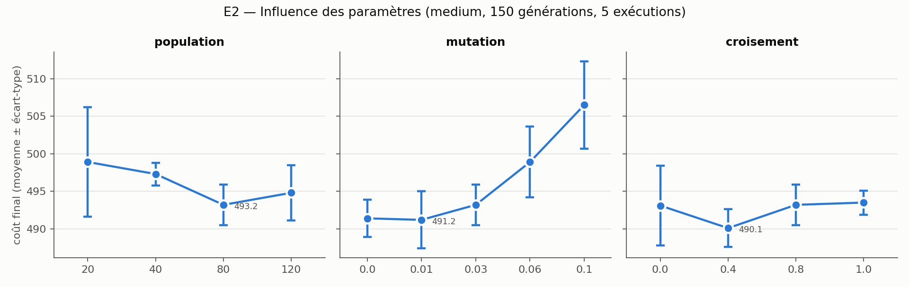

## E2 — Paramètres

| variant | cout_moyen | ecart_type | meilleur | pire | faisables | duree_s | evaluations |
|---|---|---|---|---|---|---|---|
| population=20 | 498.9 | 7.3 | 493.0 | 508.0 | 100 % | 3.1 | 3949.0 |
| population=40 | 497.3 | 1.5 | 494.9 | 498.7 | 100 % | 7.4 | 9222.0 |
| population=80 | 493.2 | 2.7 | 490.0 | 497.0 | 100 % | 20.0 | 19842.0 |
| population=120 | 494.8 | 3.7 | 488.3 | 497.8 | 100 % | 26.5 | 30795.0 |
| mutation=0.0 | 491.4 | 2.5 | 488.6 | 494.8 | 100 % | 8.2 | 9717.0 |
| mutation=0.01 | 491.2 | 3.8 | 487.5 | 496.4 | 100 % | 10.7 | 14938.0 |
| mutation=0.03 | 493.2 | 2.7 | 490.0 | 497.0 | 100 % | 14.7 | 19842.0 |
| mutation=0.06 | 498.9 | 4.7 | 492.5 | 504.8 | 100 % | 18.8 | 21998.0 |
| mutation=0.1 | 506.5 | 5.8 | 499.7 | 512.9 | 100 % | 20.1 | 22901.0 |
| croisement=0.0 | 493.1 | 5.3 | 487.5 | 501.0 | 100 % | 8.7 | 14019.0 |
| croisement=0.4 | 490.1 | 2.5 | 487.6 | 494.3 | 100 % | 11.5 | 16708.0 |
| croisement=0.8 | 493.2 | 2.7 | 490.0 | 497.0 | 100 % | 13.2 | 19842.0 |
| croisement=1.0 | 493.5 | 1.6 | 492.0 | 496.1 | 100 % | 15.0 | 21852.0 |