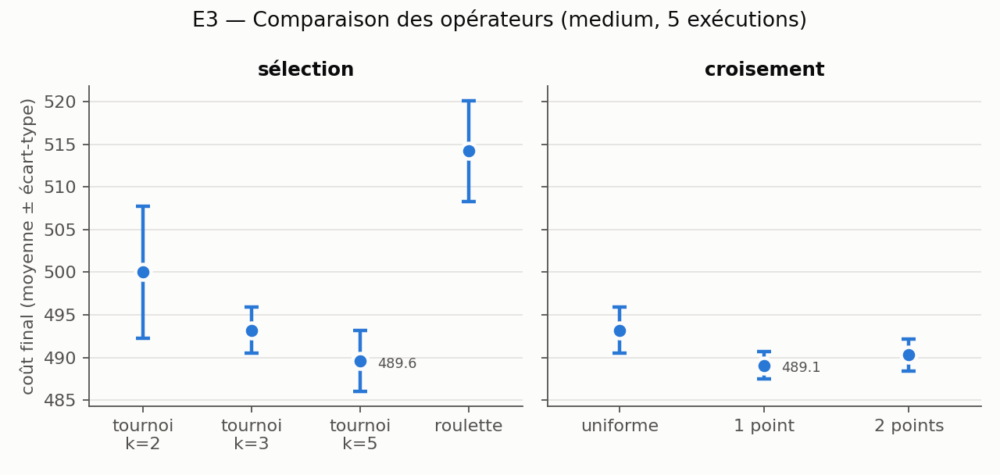

## E3 — Opérateurs

| variant | cout_moyen | ecart_type | meilleur | pire | faisables | duree_s | evaluations |
|---|---|---|---|---|---|---|---|
| sélection=tournoi k=2 | 500.0 | 7.7 | 490.3 | 509.8 | 100 % | 16.3 | 21061.0 |
| sélection=tournoi k=3 | 493.2 | 2.7 | 490.0 | 497.0 | 100 % | 13.4 | 19842.0 |
| sélection=tournoi k=5 | 489.6 | 3.6 | 486.5 | 494.1 | 100 % | 12.6 | 18068.0 |
| sélection=roulette | 514.2 | 5.9 | 507.4 | 521.4 | 100 % | 16.6 | 21475.0 |
| croisement=uniforme | 493.2 | 2.7 | 490.0 | 497.0 | 100 % | 13.1 | 19842.0 |
| croisement=1 point | 489.1 | 1.6 | 487.0 | 491.5 | 100 % | 11.4 | 17810.0 |
| croisement=2 points | 490.3 | 1.9 | 488.3 | 493.1 | 100 % | 12.5 | 18214.0 |