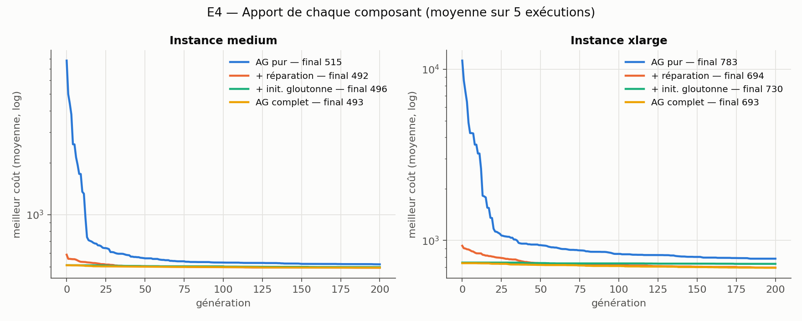

## E4 — Composants

| instance | variant | 1re génération faisable (moy.) | cout_moyen | ecart_type | meilleur | pire | faisables | duree_s | evaluations |
|---|---|---|---|---|---|---|---|---|---|
| medium | AG pur | 11.4 | 515.2 | 8.2 | 502.9 | 523.3 | 100 % | 7.4 | 14522.0 |
| medium | + réparation | 0.0 | 492.1 | 2.1 | 489.6 | 494.3 | 100 % | 17.9 | 26214.0 |
| medium | + init. gloutonne | 0.0 | 496.4 | 3.7 | 491.1 | 501.1 | 100 % | 6.9 | 14358.0 |
| medium | AG complet | 0.0 | 492.9 | 4.0 | 487.6 | 497.4 | 100 % | 17.0 | 25854.0 |
| xlarge | AG pur | 15.2 | 782.6 | 22.3 | 762.8 | 816.5 | 100 % | 10.1 | 15207.0 |
| xlarge | + réparation | 0.0 | 694.1 | 7.3 | 686.1 | 701.7 | 100 % | 27.5 | 27483.0 |
| xlarge | + init. gloutonne | 0.0 | 730.1 | 7.1 | 722.8 | 740.5 | 100 % | 10.5 | 15202.0 |
| xlarge | AG complet | 0.0 | 692.7 | 13.7 | 671.2 | 703.9 | 100 % | 24.3 | 27346.0 |