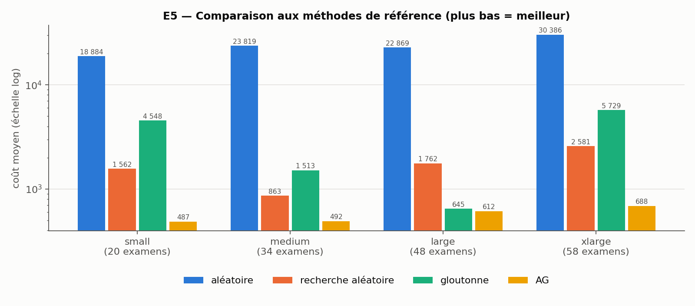

## E5 — Comparaison aux méthodes de référence

Budget de la recherche aléatoire = nombre moyen d'évaluations de l'AG : {'small': 17091, 'medium': 34617, 'large': 37487, 'xlarge': 40248}

| instance | variant | violations dures (moy.) | cout_moyen | ecart_type | meilleur | pire | faisables | duree_s | evaluations |
|---|---|---|---|---|---|---|---|---|---|
| small | aléatoire | 18.3 | 18883.9 | 7928.4 | 6535.2 | 40562.1 | 0 % | 0.0 | 1.0 |
| small | recherche aléatoire | 1.0 | 1561.8 | 699.2 | 548.4 | 2524.2 | 20 % | 3.6 | 17091.0 |
| small | gloutonne | 4.0 | 4548.0 | nan | 4548.0 | 4548.0 | 0 % | 0.0 | 1.0 |
| small | AG | 0.0 | 487.1 | 0.0 | 487.1 | 487.1 | 100 % | 8.2 | 17091.0 |
| medium | aléatoire | 23.0 | 23818.7 | 8379.2 | 8858.2 | 45604.6 | 0 % | 0.0 | 1.0 |
| medium | recherche aléatoire | 0.0 | 863.0 | 60.8 | 796.6 | 949.3 | 100 % | 13.3 | 34617.0 |
| medium | gloutonne | 1.0 | 1513.4 | nan | 1513.4 | 1513.4 | 0 % | 0.0 | 1.0 |
| medium | AG | 0.0 | 492.3 | 3.4 | 487.4 | 497.4 | 100 % | 31.0 | 34618.0 |
| large | aléatoire | 21.8 | 22869.3 | 9539.0 | 11036.1 | 44110.2 | 0 % | 0.0 | 1.0 |
| large | recherche aléatoire | 0.6 | 1762.3 | 824.3 | 1135.6 | 3080.9 | 60 % | 19.6 | 37487.0 |
| large | gloutonne | 0.0 | 645.0 | nan | 645.0 | 645.0 | 100 % | 0.0 | 1.0 |
| large | AG | 0.0 | 612.5 | 3.2 | 609.5 | 619.0 | 100 % | 32.3 | 37488.0 |
| xlarge | aléatoire | 29.2 | 30386.0 | 12303.6 | 13307.0 | 59073.4 | 0 % | 0.0 | 1.0 |
| xlarge | recherche aléatoire | 1.4 | 2580.6 | 554.5 | 2095.6 | 3232.9 | 0 % | 22.7 | 40248.0 |
| xlarge | gloutonne | 5.0 | 5729.1 | nan | 5729.1 | 5729.1 | 0 % | 0.0 | 1.0 |
| xlarge | AG | 0.0 | 687.9 | 12.0 | 666.8 | 698.7 | 100 % | 42.9 | 40248.0 |