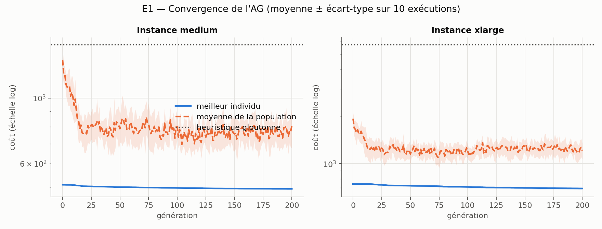
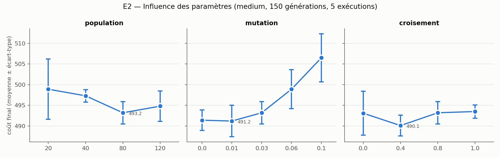
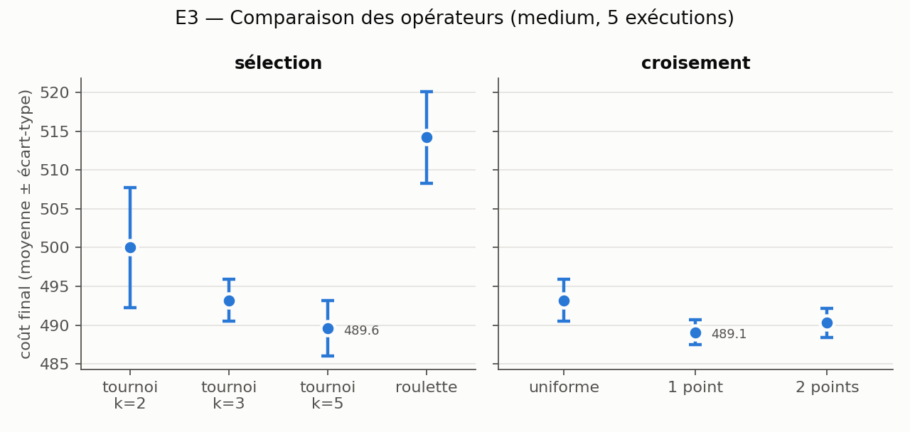
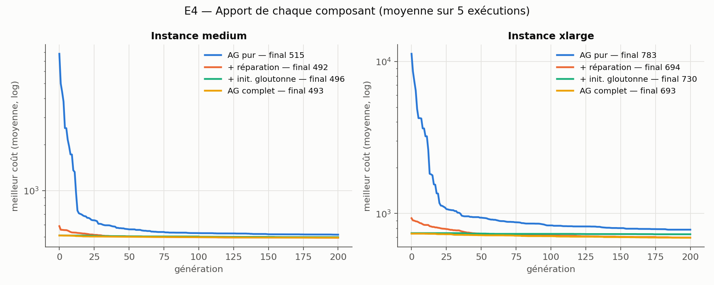
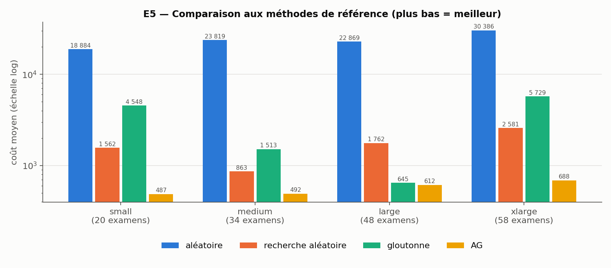
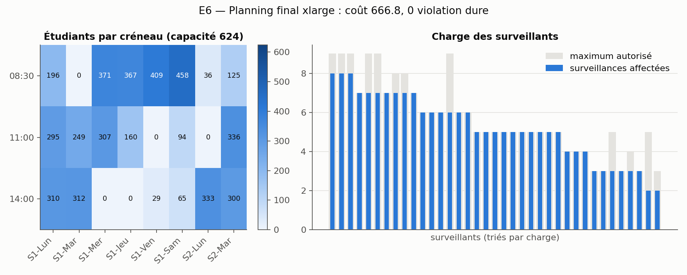

# Résultats des expériences

## E1 — Convergence

| instance | 1re génération faisable (moy.) | cout_moyen | ecart_type | meilleur | pire | faisables | duree_s | evaluations |
|---|---|---|---|---|---|---|---|---|
| medium | 0.0 | 492.8 | 3.4 | 487.6 | 497.4 | 100 % | 21.9 | 25903.0 |
| xlarge | 0.0 | 694.6 | 13.3 | 671.2 | 719.5 | 100 % | 29.5 | 27307.0 |

## E2 — Paramètres

| variant | cout_moyen | ecart_type | meilleur | pire | faisables | duree_s | evaluations |
|---|---|---|---|---|---|---|---|
| population=20 | 498.9 | 7.3 | 493.0 | 508.0 | 100 % | 3.1 | 3949.0 |
| population=40 | 497.3 | 1.5 | 494.9 | 498.7 | 100 % | 7.4 | 9222.0 |
| population=80 | 493.2 | 2.7 | 490.0 | 497.0 | 100 % | 20.0 | 19842.0 |
| population=120 | 494.8 | 3.7 | 488.3 | 497.8 | 100 % | 26.5 | 30795.0 |
| mutation=0.0 | 491.4 | 2.5 | 488.6 | 494.8 | 100 % | 8.2 | 9717.0 |
| mutation=0.01 | 491.2 | 3.8 | 487.5 | 496.4 | 100 % | 10.7 | 14938.0 |
| mutation=0.03 | 493.2 | 2.7 | 490.0 | 497.0 | 100 % | 14.7 | 19842.0 |
| mutation=0.06 | 498.9 | 4.7 | 492.5 | 504.8 | 100 % | 18.8 | 21998.0 |
| mutation=0.1 | 506.5 | 5.8 | 499.7 | 512.9 | 100 % | 20.1 | 22901.0 |
| croisement=0.0 | 493.1 | 5.3 | 487.5 | 501.0 | 100 % | 8.7 | 14019.0 |
| croisement=0.4 | 490.1 | 2.5 | 487.6 | 494.3 | 100 % | 11.5 | 16708.0 |
| croisement=0.8 | 493.2 | 2.7 | 490.0 | 497.0 | 100 % | 13.2 | 19842.0 |
| croisement=1.0 | 493.5 | 1.6 | 492.0 | 496.1 | 100 % | 15.0 | 21852.0 |

## E3 — Opérateurs

| variant | cout_moyen | ecart_type | meilleur | pire | faisables | duree_s | evaluations |
|---|---|---|---|---|---|---|---|
| sélection=tournoi k=2 | 500.0 | 7.7 | 490.3 | 509.8 | 100 % | 16.3 | 21061.0 |
| sélection=tournoi k=3 | 493.2 | 2.7 | 490.0 | 497.0 | 100 % | 13.4 | 19842.0 |
| sélection=tournoi k=5 | 489.6 | 3.6 | 486.5 | 494.1 | 100 % | 12.6 | 18068.0 |
| sélection=roulette | 514.2 | 5.9 | 507.4 | 521.4 | 100 % | 16.6 | 21475.0 |
| croisement=uniforme | 493.2 | 2.7 | 490.0 | 497.0 | 100 % | 13.1 | 19842.0 |
| croisement=1 point | 489.1 | 1.6 | 487.0 | 491.5 | 100 % | 11.4 | 17810.0 |
| croisement=2 points | 490.3 | 1.9 | 488.3 | 493.1 | 100 % | 12.5 | 18214.0 |

## E4 — Composants

| instance | variant | 1re génération faisable (moy.) | cout_moyen | ecart_type | meilleur | pire | faisables | duree_s | evaluations |
|---|---|---|---|---|---|---|---|---|---|
| medium | AG pur | 11.4 | 515.2 | 8.2 | 502.9 | 523.3 | 100 % | 7.4 | 14522.0 |
| medium | + réparation | 0.0 | 492.1 | 2.1 | 489.6 | 494.3 | 100 % | 17.9 | 26214.0 |
| medium | + init. gloutonne | 0.0 | 496.4 | 3.7 | 491.1 | 501.1 | 100 % | 6.9 | 14358.0 |
| medium | AG complet | 0.0 | 492.9 | 4.0 | 487.6 | 497.4 | 100 % | 17.0 | 25854.0 |
| xlarge | AG pur | 15.2 | 782.6 | 22.3 | 762.8 | 816.5 | 100 % | 10.1 | 15207.0 |
| xlarge | + réparation | 0.0 | 694.1 | 7.3 | 686.1 | 701.7 | 100 % | 27.5 | 27483.0 |
| xlarge | + init. gloutonne | 0.0 | 730.1 | 7.1 | 722.8 | 740.5 | 100 % | 10.5 | 15202.0 |
| xlarge | AG complet | 0.0 | 692.7 | 13.7 | 671.2 | 703.9 | 100 % | 24.3 | 27346.0 |

## E5 — Comparaison aux méthodes de référence

Budget de la recherche aléatoire = nombre moyen d'évaluations de l'AG : {'small': 17091, 'medium': 34617, 'large': 37487, 'xlarge': 40248}

| instance | variant | violations dures (moy.) | cout_moyen | ecart_type | meilleur | pire | faisables | duree_s | evaluations |
|---|---|---|---|---|---|---|---|---|---|
| small | aléatoire | 18.3 | 18883.9 | 7928.4 | 6535.2 | 40562.1 | 0 % | 0.0 | 1.0 |
| small | recherche aléatoire | 1.0 | 1561.8 | 699.2 | 548.4 | 2524.2 | 20 % | 3.6 | 17091.0 |
| small | gloutonne | 4.0 | 4548.0 | nan | 4548.0 | 4548.0 | 0 % | 0.0 | 1.0 |
| small | AG | 0.0 | 487.1 | 0.0 | 487.1 | 487.1 | 100 % | 8.2 | 17091.0 |
| medium | aléatoire | 23.0 | 23818.7 | 8379.2 | 8858.2 | 45604.6 | 0 % | 0.0 | 1.0 |
| medium | recherche aléatoire | 0.0 | 863.0 | 60.8 | 796.6 | 949.3 | 100 % | 13.3 | 34617.0 |
| medium | gloutonne | 1.0 | 1513.4 | nan | 1513.4 | 1513.4 | 0 % | 0.0 | 1.0 |
| medium | AG | 0.0 | 492.3 | 3.4 | 487.4 | 497.4 | 100 % | 31.0 | 34618.0 |
| large | aléatoire | 21.8 | 22869.3 | 9539.0 | 11036.1 | 44110.2 | 0 % | 0.0 | 1.0 |
| large | recherche aléatoire | 0.6 | 1762.3 | 824.3 | 1135.6 | 3080.9 | 60 % | 19.6 | 37487.0 |
| large | gloutonne | 0.0 | 645.0 | nan | 645.0 | 645.0 | 100 % | 0.0 | 1.0 |
| large | AG | 0.0 | 612.5 | 3.2 | 609.5 | 619.0 | 100 % | 32.3 | 37488.0 |
| xlarge | aléatoire | 29.2 | 30386.0 | 12303.6 | 13307.0 | 59073.4 | 0 % | 0.0 | 1.0 |
| xlarge | recherche aléatoire | 1.4 | 2580.6 | 554.5 | 2095.6 | 3232.9 | 0 % | 22.7 | 40248.0 |
| xlarge | gloutonne | 5.0 | 5729.1 | nan | 5729.1 | 5729.1 | 0 % | 0.0 | 1.0 |
| xlarge | AG | 0.0 | 687.9 | 12.0 | 666.8 | 698.7 | 100 % | 42.9 | 40248.0 |

## E6 — Planning final (xlarge)

Coût 666.8 — classeur : `E6_planning_xlarge.xlsx`

- **H1** : 0
- **H2** : 0
- **H3** : 0
- **H4** : 0
- **H5** : 0
- **S1** : 9
- **S2** : 125
- **S3** : 42
- **S4** : 1.6787
- **S5** : 1010
